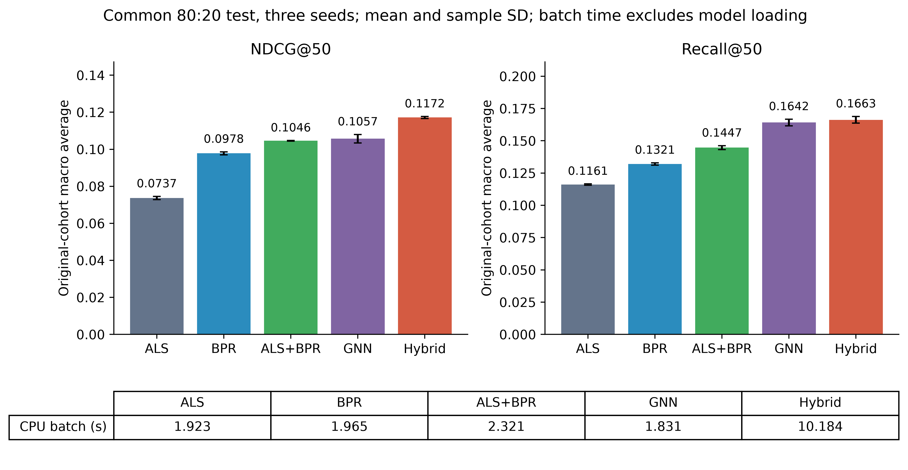
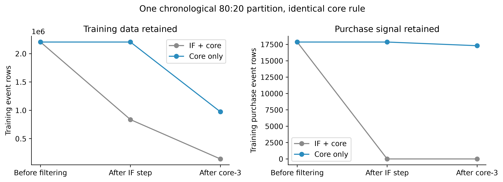
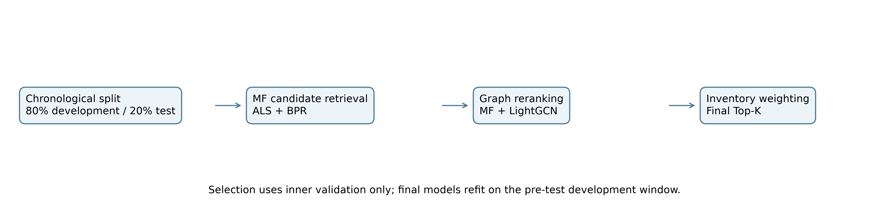
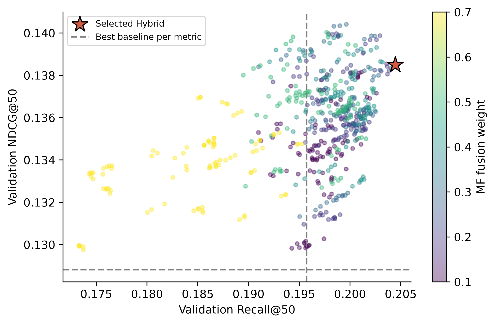
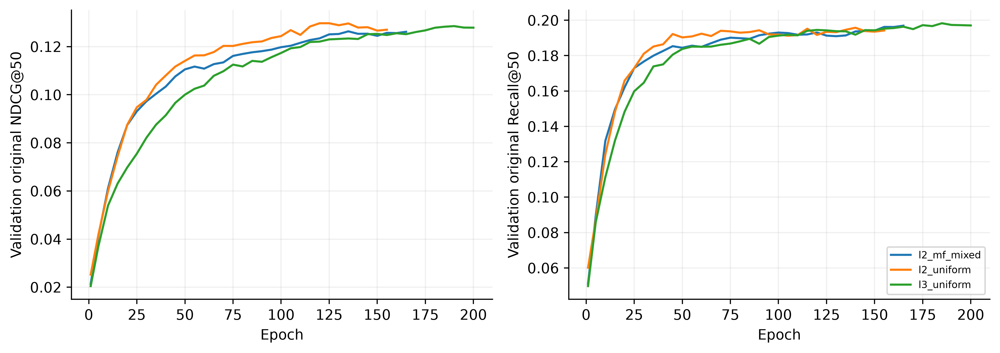
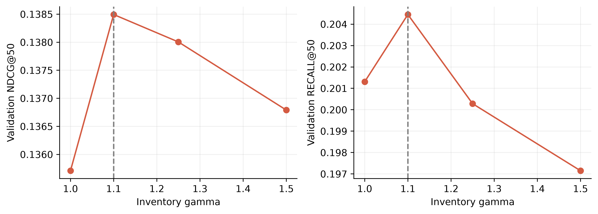
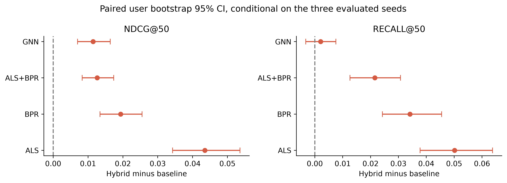
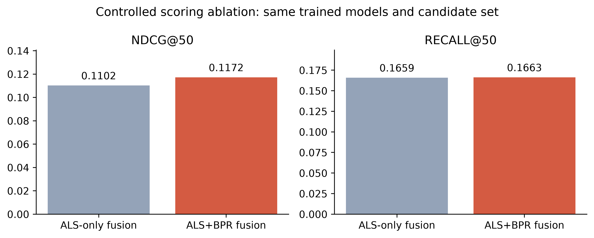

> **감사 후 안내 (2026-10-22 추가)**: 이 문서는 v5 결과 기준이다. v5는 v3 시험 결과를 본 뒤 설계를 바꿨고 같은 시험 구간을 다시 열었다. 사전등록 재평가(v6 3 fold, v7)에서 Hybrid는 가장 강한 학습 baseline보다 일관되게 유의하게 높지 않았고, "NDCG +10.83%"는 재현되지 않았다. 검증된 결과는 `README_KO.md`의 안내와 `../audit/validation_report.md`를 본다. 아래 원문은 이력으로 보존한다.

Hybrid 추천 모델 개정 실험 보고

권유희 교수님 검토용 · 2026년 10월 17일 · 공통 시간순 분할과 실제 재실험 결과

Hybrid가 두 지표의 세 seed 평균 모두 가장 높았습니다. RetailRocket의 공통 시간순 80:20 분할에서 seed 42·43·44의 평균을 비교했습니다. Hybrid의 NDCG@50은 0.117177, Recall@50은 0.166260입니다.

각 지표의 가장 강한 비교 모델 대비 상대 차이는 NDCG +10.83%, Recall +1.27%입니다. 이 문서의 결과는 기존 논문의 점수를 재사용하지 않고 이번 실행에서 산출한 값입니다.

LightGCN 대비 Recall 평균 차이는 +0.002078이지만 사용자 bootstrap 95% 신뢰구간 [-0.003267, +0.007539]은 0을 포함합니다. 평균 1위와 통계적으로 확실한 Recall 우위는 구분해야 합니다.

모델 | NDCG@50 평균 ± SD | Recall@50 평균 ± SD

ALS | 0.073666 ± 0.000878 | 0.116106 ± 0.000516

BPR | 0.097831 ± 0.000797 | 0.132095 ± 0.000877

ALS+BPR | 0.104564 ± 0.000162 | 0.144725 ± 0.001478

GNN | 0.105724 ± 0.002282 | 0.164182 ± 0.002525

Hybrid | 0.117177 ± 0.000536 | 0.166260 ± 0.002588

정답은 시험 구간의 장바구니·구매 상품 집합입니다. 모든 모델의 성적표 분모는 동일한 854명이며, Hybrid에서 추천 목록이 없는 425명도 0점으로 포함했습니다. ±는 세 seed의 표본 표준편차이며 신뢰구간과 다릅니다.

평가 대상은 필터 전 학습에서 관측된 사용자 중 시험 양성 상품이 하나 이상 필터 전 학습 catalog에 있는 사람입니다. 그 사용자의 새 상품을 포함한 전체 시험 양성을 original 정답으로 둡니다. 전체 신규 사용자까지 포함한 서비스 이용자 전체의 결과는 아닙니다.

각 seed에서 평균적으로 MF만 정답을 포함한 사용자는 16.3명, GNN만 정답을 포함한 사용자는 30.0명이었습니다. 두 모델이 맞히는 대상이 다르다는 점을 사용자별 추천 목록에서 확인했습니다. 이 차이가 실제 Hybrid 이득으로 이어지는지는 뒤의 통제 비교와 신뢰구간을 함께 봐야 합니다.

---

분할과 구매 제거 문제를 확인한 결과

학습 구간에서 validation을 분리하고 설정 선택 후 재학습하는 것은 정상입니다. 이번 분할은 상품 ID가 아닌 이벤트 기준입니다. 학습에 등장했던 상품만 점수를 낼 수 있으며, 미학습 상품은 original 정답에서 실패로 남깁니다.

구간 | 필터 전 이벤트 | core 이후 학습 이벤트 | 용도

내부 학습 | 1,763,904 | 772,302 | 모델 학습

내부 validation | 440,976 | 해당 없음 | epoch와 설정 선택

최종 재학습 | 2,204,880 | 974,155 | 설정 확정 후 재학습

바깥 test | 551,221 | 해당 없음 | 최종 성능 계산

원본 코드 재구성 자료에서는 학습 pair와 validation pair의 직접 중복은 0개였습니다. 그러나 validation 139,306개가 모두 분할 전에 생성한 전파 그래프에 들어 있었습니다. 이번 구현은 내부 학습 구간만으로 그래프를 만듭니다.

original 평가자는 854명이고, 사용자 벡터가 남는 사람은 429명입니다. 정답 상품까지 남는 conditional 평가자 409명과는 다릅니다. 현재 지원 범위에서 전체 카탈로그를 이상적으로 정렬한 Recall@50 상한은 0.4451입니다.

최종 학습은 사용자 141,660명, 상품 58,556개, 이벤트 974,155행입니다. 고유 사용자·상품 쌍은 562,419개이며 이 쌍을 기준으로 한 행렬 희소도는 99.99322%입니다. 반복 이벤트 행 수와 고유 쌍 수를 구분했습니다.

동일 8:2 구간에서 IF를 적용하면 학습 구매 17,864건이 IF 단계에서 모두 제거됐습니다. IF 없이 core만 적용하면 17,305건이 남습니다. 원본 코드 재구성에서도 학습 구매는 0건이므로 8:2 통일 뒤 새로 생긴 문제라고 단정하지 않습니다. 재구성 자료는 투고 당시 원본 실행 기록을 대신하지 않습니다.

학습 구간 IF 특징 비교 | IF 이후 남은 구매

원래 9개 특징 | 0

행동코드 평균과 표준편차 제외 | 3,476

행동코드 평균과 표준편차만 사용 | 0

원래 설정을 재적합한 라벨은 저장 라벨과 100.0% 일치했습니다. 행동코드 특징을 제외하면 구매 일부가 복구되지만 대부분은 여전히 제거됩니다. 따라서 행동코드만의 단독 문제로 설명할 수 없습니다.

---

코드에서 바꾼 부분과 선택 근거

MF 신호 보존 원고 식 8은 후보 점수인 ALS+BPR과 GNN 점수를 결합합니다. 기존 코드는 최종 결합에 ALS만 사용했습니다. 이를 수정해 BPR이 후보 검색 이후에도 최종 순위에 기여하도록 했습니다.

후보 검색 MF 결합 점수로 검색하는 방식과 ALS·BPR 후보를 균형 있게 합치는 방식을 비교했습니다. GNN으로 전체 카탈로그를 검색하는 방식으로 바꾸지는 않았습니다.

공동 선택 기준 validation NDCG만 최대화하는 대신 NDCG와 Recall의 상대 개선율 중 작은 값을 최대화했습니다. 한 지표가 좋아지는 대신 다른 지표가 나빠지는 설정을 피하려는 기준입니다.

첫 v3 실행은 NDCG는 1위였지만 Recall은 LightGCN보다 낮았습니다. 이를 확인한 후 추가 연구로 seed 42·43·44의 내부 validation 평균으로 설정을 다시 선택했습니다. 기존 3층 LightGCN 비교 모델은 유지했습니다. 추가 설정 선택 함수에는 바깥 test 지표를 입력하지 않았습니다.

GNN 학습 64차원 2층·3층 LightGCN에서 행동 가중 InfoNCE를 사용했습니다. 음성 수는 32개, 온도는 0.2입니다. 균등·MF 기반 혼합 표본을 비교하고 학습 이력 상품을 음성에서 제외했습니다. 학습 MF도 같은 학습 구간만 사용합니다. 원고의 GNN BPR 손실 설명은 실제 목적함수에 맞춰 수정해야 합니다.

최종 융합 후보 안에서 MF와 GNN 점수를 각각 min-max 정규화한 뒤 가중합합니다. MF 점수는 ALS 단독이 아니라 ALS+BPR 결합 점수입니다.

점선은 각 지표의 가장 강한 validation 비교 모델을 나타냅니다. 별표는 공동 기준으로 선택한 Hybrid입니다. 점과 색은 실제 설정 탐색 CSV에서 생성했습니다. 이 그림은 세 validation seed의 평균입니다.

---

학습과 하이퍼파라미터 선택 결과

항목 | 선택값

GNN 조건 | 3층 · uniform · 64차원

Hybrid 학습 길이 | 190 epoch

후보 검색 | balanced_union

후보 수 | 20000

ALS 비중과 MF 융합 비중 | 후보 alpha 0.5 · 최종 omega 0.3

최종 융합과 재고 가중 | minmax · gamma 1.1

학습 곡선은 seed 42에서 epoch를 선택한 초기 내부 validation 이력입니다. gamma 민감도는 세 validation seed 평균입니다. 최종 test 곡선으로 gamma나 epoch를 선택하지 않았습니다. gamma가 1이면 재고 가중은 중립입니다.

재고 가중은 학습 종료 전에 관측한 마지막 available 값을 사용하고 미상 상품에는 부스팅을 적용하지 않습니다. 시험 기간의 실시간 재고나 매출 효과를 검증한 결과는 아닙니다.

seed 42 validation에서 실제 출력된 추천 항목 중 알려진 가용 상품 비율은 중립 가중에서 75.3%, 선택한 가중에서 88.5%였습니다. 이 항목 비율의 분모는 출력된 추천 수이며 성능 지표의 사용자 분모와 다릅니다.

---

효과의 범위와 교수님 질문에 대한 답변

사용자 단위 paired bootstrap 95% 개별 신뢰구간을 계산했으며 다중비교 보정은 하지 않았습니다. 8개 비교 중 하한이 0보다 큰 비교는 7개입니다. 이 구간은 평가한 세 seed에 조건부인 사용자 불확실성이며, 다른 시점이나 다른 데이터셋에 대한 일반화 증거는 아닙니다.

통제 조건 | NDCG@50 | Recall@50

Hybrid 전체 | 0.117177 | 0.166260

재고 가중 없음 | 0.115334 | 0.164483

GNN 점수 없음 같은 재고 가중 | 0.106011 | 0.145589

MF 점수 없음 같은 후보와 재고 가중 | 0.109571 | 0.167101

동일 GNN 가중치 전체 상품 평가 | 0.105724 | 0.164182

Validation이 학습에 중복됐는가 원본의 문제는 파일 pair 중복이 아니라 전파 그래프에 검증 관계가 남은 것이었습니다. 이번 검증 단계와 최종 재학습 단계는 분리되어 있습니다.

왜 구매가 제거됐는가 구매 이력이 있는 상품들이 IF 이상치로 분류되면서 해당 상품의 모든 이벤트가 제거됐습니다. 행동코드 두 특징을 제외하면 구매 3,476건이 남지만 14,388건은 여전히 제거됩니다. 행동코드와 나머지 특징들의 영향을 함께 봐야 하며, 봇을 식별한 결과로 설명하지 않습니다.

원고에서 수정할 내용 공통 8:2와 정답 집합, 식 6~9의 실제 점수 계산, 이분그래프 구조, 데이터 손실 통계, 성능과 실행시간 표, 그림 번호와 해상도를 함께 수정해야 합니다. 속성·카테고리 그래프 및 cold-start 해결 주장은 현재 구현에 맞게 조정해야 합니다.

---

재현 방법과 판단의 한계

최종 설정을 selection.json으로 확정한 뒤 데이터·수치 학습 조건·seed·epoch가 맞는 모델을 연결했습니다. 이미 완료된 동일 조건의 재학습 모델은 재사용했으며 새로 학습한 것처럼 계산하지 않았습니다. 각 seed의 완료 파일은 새 설정 해시를 참조하고 추천·평가 CSV는 새로 생성했습니다. synthetic 검사는 실제 데이터 성능을 대신하지 않습니다.

재사용 모듈의 selection_metric 문구는 고정값이어서 실제 선택 방식과 다를 수 있습니다. 원본 메타데이터를 보존하고 effective_training_protocol.json에 실제 선택·고정 epoch 이력·재사용 출처를 연결했습니다. 여섯 모델 기록의 epoch·모드·분할이 새 설정과 같은지 독립 검산했습니다.

이번 선택 및 최종 평가 단계의 기록 시간은 1.34시간입니다. 재사용 모델의 앞선 생성 시간은 이 값에 포함되지 않습니다. 학습 환경과 장비는 experiment_plan.json, 코드 및 데이터 식별자는 각 manifest에 기록했습니다.

과거 프로젝트의 test 결과와 v3의 Recall 미달 결과를 이미 검토한 후 추가 연구를 수행했습니다. 설정의 수치 선택에는 내부 validation만 사용했지만, 연구 방향 결정까지 포함해 시험과 완전히 독립적이었다고 주장하지 않습니다. 단일 데이터셋·단일 시간 구간·세 seed의 정정 평가라는 범위를 명시합니다.

투고 원고의 NDCG 0.3710과 Recall 0.7113은 이번과 데이터 분할·후보 처리·평가 분모가 다릅니다. 해당 숫자와 이번 결과를 같은 조건의 전후 성능으로 비교하거나 상대 개선율을 계산하지 않습니다.

데이터는 2015년 5~9월의 단일 전자상거래 서비스 로그입니다. 행동·상품·재고 분포가 다른 서비스나 현재 시점의 데이터로 일반화됐다는 증거는 아니며, 신규 사용자와 미관측 상품의 cold-start 성능도 입증하지 않았습니다.

동일 후보·재고 가중에서 MF 점수를 뺀 통제 조건의 Recall은 0.167101로 Hybrid보다 높았지만 NDCG는 0.109571로 낮았습니다. 따라서 모든 구성요소가 모든 지표를 높인다고 주장하지 않고, 주요 비교 모델 대비 평균 성능과 지표 사이의 균형을 구분해 해석합니다.

모델 | 학습 초 | 배치 추천 초 | 사용자당 환산 ms

ALS | 80.8 | 1.923 | 4.48

BPR | 45.7 | 1.965 | 4.58

ALS+BPR | 126.5 | 2.321 | 5.41

GNN | 1200.1 | 1.831 | 4.27

Hybrid | 1326.6 | 10.184 | 23.74

추천 시간은 모델 로딩을 제외하고 실제 점수를 계산하는 429명의 배치를 CPU에서 3회 실행한 중앙값을 seed별로 구한 뒤 평균한 값입니다. 사용자당 값은 이 배치 시간을 429명으로 나눈 환산치이며 온라인 응답 지연시간이 아닙니다. MF 기반 음성 채굴을 사용한 GNN의 학습 시간에는 MF 의존 비용을 포함합니다.

이 측정에서 Hybrid의 배치 추천 시간은 GNN 단독의 5.56배였습니다. GNN 점수를 계산하는 후보 수가 줄어도 MF 검색 비용이 추가되므로 전체 속도 향상을 보장하지는 않습니다. 원고의 계산 효율 우위 주장은 이 측정 범위에 맞춰 수정해야 합니다.

파일 또는 폴더 | 내용

EXECUTION_PLAN_KO.md | 실행 전 고정한 목표와 절차

results/hybrid_joint_8020_v5/experiment_metrics.csv | 모델별 seed별 Top-K 실제 지표

results/hybrid_joint_8020_v5/selection.json | validation에서 선택한 설정과 hash

results/hybrid_joint_8020_v5/runs | 재학습 결과와 사용자별 평가

professor_materials/evidence.json | 분할 통계와 원본 문제의 근거

professor_materials/figures | 고해상도 PNG와 벡터 PDF SVG

regression_final.log | 최종 회귀검사 결과

재현 명령과 파일별 위치는 같은 폴더의 README_KO.md와 상위 폴더의 README_HYBRID_KO.md에 정리했습니다. 결과 CSV, 실행 로그, 선택 근거와 소스는 함께 보존했습니다.

재실행 예시: robust_hybrid.py에 --parent로 보존된 v3 결과 경로를 전달하고 --output-dir에 새 빈 폴더를 지정합니다. 최초 준비부터의 절차는 README_HYBRID_KO.md에 있습니다. 기존 결과 디렉터리에 다른 코드나 설정으로 이어 쓰지 않습니다.

제안된 알고리즘 수정과 결과는 연구팀의 검토를 위한 자료입니다. 교수님께 직접 전송하거나 논문을 재투고하는 작업은 수행하지 않았습니다.

---

부록: 전처리 수치와 실제 IF 입력

조건과 단계 | 사용자 | 상품 | 이벤트 | 구매

IF 적용 필터 전 | 1,123,767 | 212,915 | 2,204,880 | 17,864

IF 적용 IF 단계 후 | 579,388 | 184,888 | 836,661 | 0

IF 적용 core 후 | 27,787 | 25,600 | 142,164 | 0

IF 없음 필터 전 | 1,123,767 | 212,915 | 2,204,880 | 17,864

IF 없음 IF 단계 후 | 1,123,767 | 212,915 | 2,204,880 | 17,864

IF 없음 core 후 | 141,660 | 58,556 | 974,155 | 17,305

IF에서 제거된 상품은 28,027개로 학습 상품의 13.16%입니다. 제거 이벤트는 1,368,219행으로 필터 전 학습의 62.05%, 원시 전체의 49.64%입니다. 상품 비율과 이벤트 비율의 분모가 다릅니다.

이번 revision 구현과 재적합 진단의 IF 입력 9개: event_count, view_count, unique_visitors, event_code_mean, event_code_std, first_event_hour, last_event_hour, event_duration_hours, property_count. 원고의 17열 특징 표와 구분합니다. 투고 당시 원본 실행 파일은 보존되지 않아 당시 입력도 완전히 같았다고 단정하지 않습니다.

IF 설정: n_estimators=200, contamination=auto, max_samples=auto, random_state=42. 원래 9개 특징을 같은 학습 구간에 재적합해 저장 라벨과 일치하는지 확인한 뒤 특징 제외 실험을 수행했습니다.

MF 후보 점수는 사용자별 전체 학습 catalog에서 ALS와 BPR를 각각 min-max 정규화한 뒤 alpha 비중으로 합칩니다. 최종 minmax 결합은 후보 안에서 다시 정규화하며, RRF를 선택한 경우 후보 내 순위의 역수를 사용합니다. 재고 가중은 최종 결합 점수에 적용합니다.

공통 학습 설정: 행동 가중 view/addtocart/transaction=1/6/12, 시간 감쇠 반감기 7일. MF 128차원, ALS 256회·alpha 2·정규화 0.02, BPR 128epoch. GNN 64차원·학습률 0.001·정규화 0.0001·edge dropout 0.1·InfoNCE 음성 32개·온도 0.2. 세부 설정과 선택한 epoch는 소스와 selection.json에 보존했습니다.

core-3은 서로 다른 이웃 3개가 아닌 이벤트 행 3개 기준입니다. 학습에서 관측했던 상품의 재추천을 모든 모델에 공통으로 허용하며, 시험 양성은 사용자별 상품 집합으로 중복 제거해 평가합니다.

시간 경계 UTC: 내부 validation 2015-07-26T06:29:44.456000+00:00 / 바깥 test 2015-08-18T04:23:31.966000+00:00. 특징·속성·전파 그래프와 음성 채굴 모델은 해당 학습 구간에서 구성했습니다.

인접 90:10 로그는 실제 학습 2,480,490행, 시험 275,611행인데 manifest.config.test_size에는 0.2가 남아 있습니다. 실제 건수와 설정 메타데이터가 불일치합니다. 이번 80:20과 섞지 않고 그대로 보존했습니다. 해당 로그의 학습 구매도 필터 전 20,326건에서 최종 0건입니다.

선택 과정: v1/v2는 내부 검증 학습과 후보 합집합 수정, v3는 후보 상한 확장과 첫 최종 시험, v4/v5는 첫 시험의 Recall 미달을 기록한 뒤 세 seed validation 평균으로 선택한 추가 실험입니다. v5는 v4와 같은 설정·선택 기준에서 중복 계산만 줄였습니다. 실패한 v3 결과와 소스도 보존했습니다.

검증 계산 가속은 실제 576설정 전체와 대조했으며 지표 최대 차이는 8.3e-17였습니다. 별도 확인한 사용자별 Top-50 247개는 원래 전체 정렬과 일치했습니다. 최종 추천 CSV 생성과 독립 검산에는 기존 평가 계산을 사용했습니다.